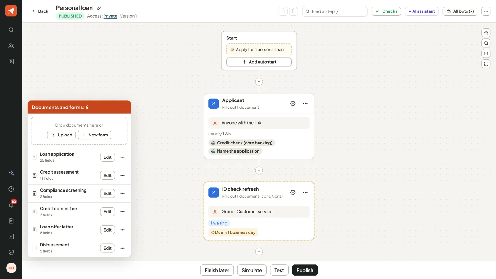
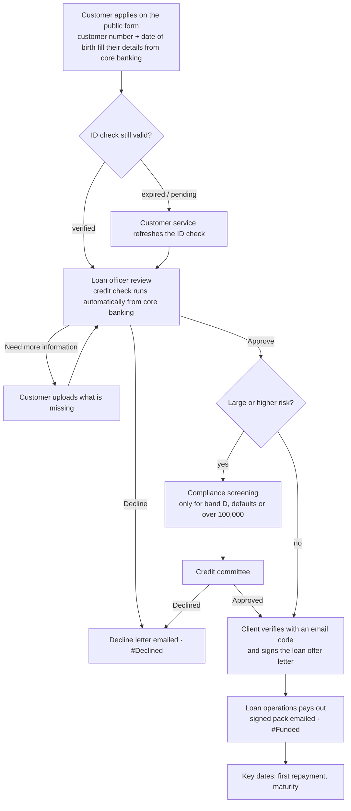
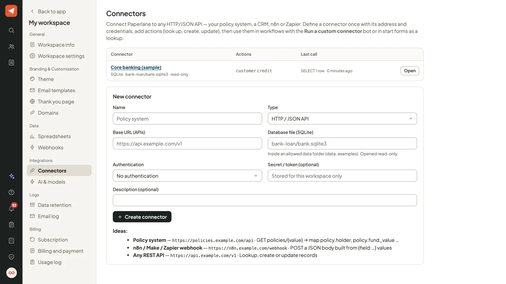
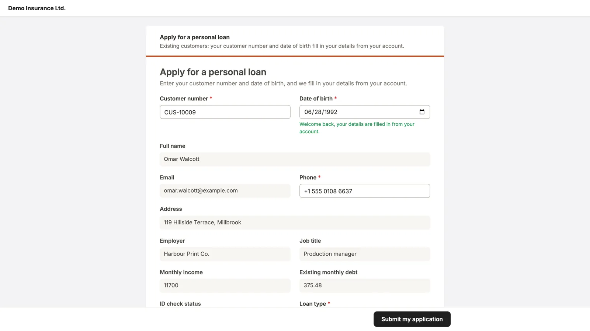
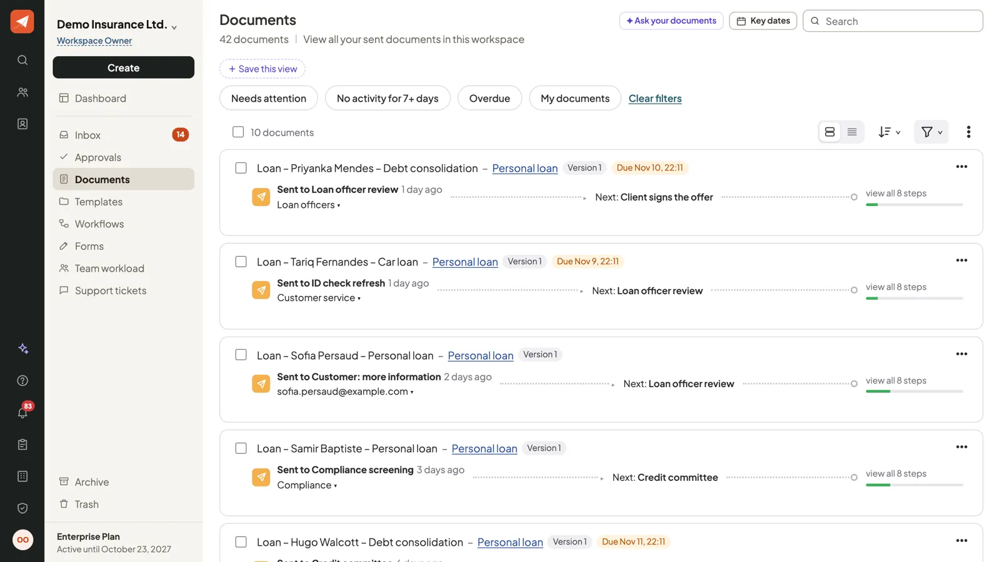
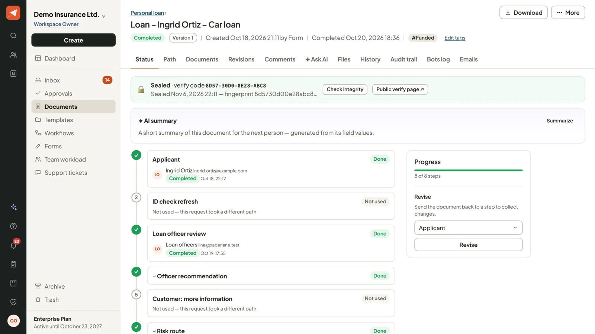
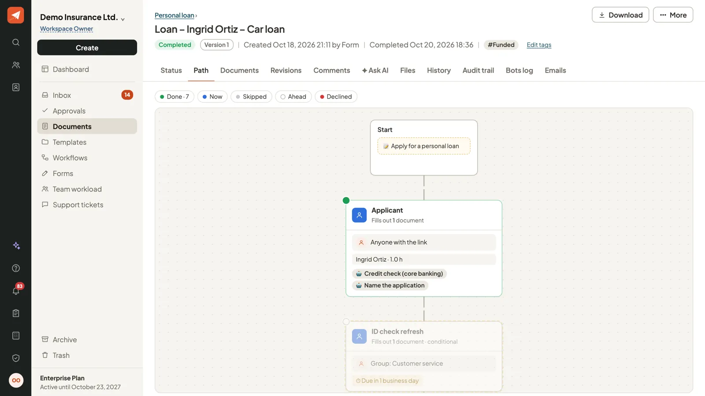
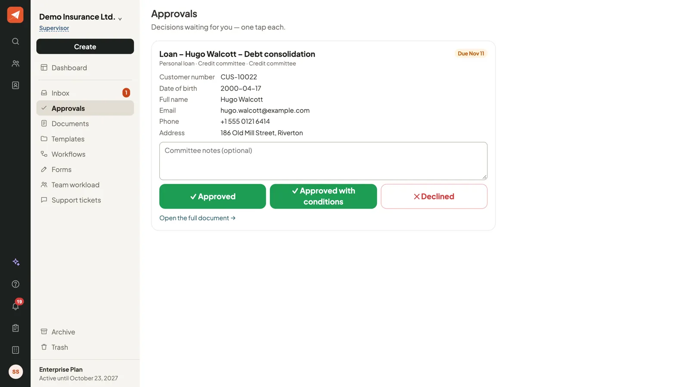
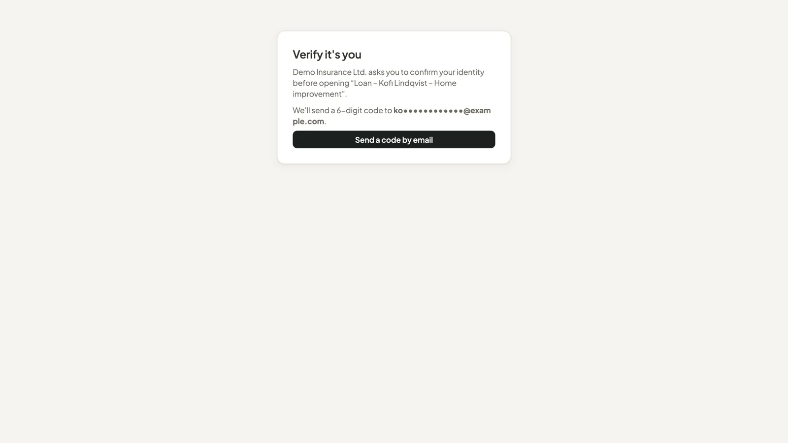

# Example: a personal loan, from application to money in the account

A complete lending process built in Paperlane and connected to a core-banking database. It shows what a real bank
workflow looks like when forms, routing, checks, signatures and records live in one place.

Everything here is **fictional**: the 40 customers, their accounts, loans and credit scores are generated by
[`make_bank_db.py`](make_bank_db.py) into [`bank.sqlite3`](bank.sqlite3).



## Try it

```bash
python manage.py migrate
python manage.py seed_demo        # demo workspace and the one-click demo accounts
python manage.py seed_bank_demo   # this example
python manage.py runserver
```

Sign in as **Olivia Owner** and open **Workflows › Personal loan**. To rebuild the example later, run
`seed_bank_demo --replace`. To regenerate the database, run `python examples/bank-loan/make_bank_db.py`.

| Step | Who | Demo account that can do it |
|------|-----|-----------------------------|
| Application (public start form) | the customer | anyone with the link |
| ID check refresh (only when the ID check expired) | Customer service | Fay Filler |
| Loan officer review | Loan officers | Fay Filler |
| Compliance screening (band D, past defaults or over 100,000) | Compliance | Cal Creator |
| Credit committee (over 50,000, band C or D, or debt-to-income over 40%) | Credit committee | Sam Supervisor |
| Client signs the offer (email code first) | the customer | link in the email log |
| Disbursement | Loan operations | Olivia Owner |

## How it works



### The connection to core banking

**Workspace › Connectors › Core banking (sample)** is a *SQLite database* connector. Paperlane opens the file
read-only, accepts a single `SELECT`, binds every `{value}` and `{field:…}` as a query parameter (so typed text can
never change the query), stops queries after 3 seconds, and only opens files inside `PAPERLANE_DATA_DIRS`
(by default `data/` and `examples/`).



It has two actions:

* **Find customer**, used by the public form. It only answers when the customer number *and* the date of birth match,
  so guessing a customer number reveals nothing:

  ```sql
  SELECT customer_id, full_name, email, phone, address, employer, job_title, monthly_income,
         existing_monthly_debt, kyc_status, kyc_expires, current_account, segment, customer_since
  FROM customer_summary
  WHERE upper(customer_id) = upper(trim({field:Customer number})) AND date_of_birth = {value}
  ```

* **Credit check**, run by a bot as soon as the application is submitted. It fills the officer's *Credit assessment*
  (score, band, defaults, days past due, enquiries, average balance):

  ```sql
  SELECT score, band, defaults_5y, enquiries_6m, max_days_past_due, avg_balance_6m, last_checked
  FROM credit_view WHERE customer_id = {field:Customer number}
  ```

To connect your own system, point a connector at your core-banking API (HTTP/JSON) or at a read-only database
export, and keep the field names.



### The documents

| Document | Filled by | What is in it |
|----------|-----------|---------------|
| Loan application | customer | details from core banking, loan type, amount, term, purpose, payslip and ID uploads, consent and signature. *Estimated monthly payment* and *Debt to income* are formulas that update as the customer types. |
| Credit assessment | loan officer | the automatic credit check, document checks, recommendation, offered amount and rate |
| Compliance screening | compliance | sanctions and PEP screening |
| Credit committee | committee | decision and conditions |
| Loan offer letter | customer | amount, rate, term, monthly repayment and total to repay (all calculated), the terms, acceptance and signature |
| Disbursement | loan operations | payout date, credited account, reference, first repayment and maturity dates |

Each step only sees the documents it needs: the customer never sees the credit assessment or committee notes, and the
committee sees everything.

### Built in

* **Deadlines:** officer review 2 business days, committee 3, disbursement 1, ID check 1, with escalation.
* **Duplicate check:** a second application from the same customer within 30 days is flagged.
* **Identity check:** the customer confirms a 6-digit email code before opening the offer letter.
* **One-tap decisions:** the committee can decide from *Approvals* without opening the form.
* **Letters:** a decline letter is emailed automatically; the signed loan pack (PDF) is emailed at payout.
* **Key dates:** first repayment (reminders 7 and 1 days before) and maturity (60, 30 and 0 days).
* **Audit:** every step, value change, bot run and email is in the audit trail, and finished loans are sealed with a
  code anyone can check at `/verify/`.



## The ten sample applications

`seed_bank_demo` runs each application through the real workflow as the real people, so each one is where its story
says:

| Customer | Loan | Where it is |
|----------|------|-------------|
| Ingrid Ortiz | Car loan 20,000 | paid out, key dates set, sealed |
| Noah Persaud | Personal loan 25,000 | offer signed, waiting for Loan operations |
| Kofi Lindqvist | Home improvement 85,000 | approved by the committee, waiting for the customer's signature |
| Hugo Walcott | Debt consolidation 15,000 (band C) | with the credit committee |
| Samir Baptiste | Personal loan 8,000 (band D) | with Compliance |
| Victor Persaud | Car loan 12,000 (in arrears) | declined by the officer, letter sent |
| Diego Ramdeen | Home improvement 60,000 | declined by the committee, letter sent |
| Sofia Persaud | Personal loan 9,000 | waiting for more documents from the customer |
| Tariq Fernandes | Car loan 30,000 (ID check expired) | with Customer service |
| Priyanka Mendes | Debt consolidation 40,000 | just submitted, in the Loan officers queue |






## Tests

`core/test_bank_example.py` checks the example end to end:

* every sample application ends at the step its story says, with the right tags;
* the credit check matches the database row for the customer;
* the formulas match a standard loan-payment calculation, and the key dates are created;
* the decline letters and the signed loan pack were sent;
* the simulator reaches every step with no problems;
* the public lookup needs both the customer number and the date of birth;
* submitting the public form starts a loan that is already credit-checked and waiting for a loan officer;
* the SQLite connector refuses writes, several statements, `ATTACH`, `PRAGMA`, extensions, slow queries and files
  outside the data folders, and treats typed values as values, never as SQL.
